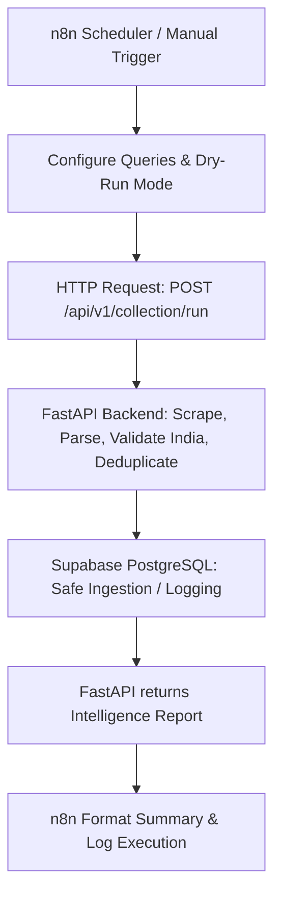

# IndiaTechIntelligence — n8n Automation Setup & Execution Guide

This guide walks you through running **n8n** on your Windows system, importing the collection workflow, and executing it alongside the FastAPI backend.

---

## 1. Architecture Overview



---

## 2. Prerequisites Check

* **Node.js**: Installed (`v22.x` verified).
* **FastAPI Backend**: Running locally on `http://127.0.0.1:8000`.
* **API Key**: `COLLECTION_API_KEY` defined in `backend/.env`.

---

## 3. Step-by-Step Instructions to Run

### Step 1: Start the FastAPI Backend

Open your **first PowerShell window** and run:

```powershell
cd d:\IndianJobsScrapping\BE\tech-jobs-BE\backend
.\.venv\Scripts\Activate.ps1
uvicorn app.main:app --reload --port 8000
```

Verify in your browser:
* Swagger UI: [http://127.0.0.1:8000/docs](http://127.0.0.1:8000/docs)
* Health check: [http://127.0.0.1:8000/health](http://127.0.0.1:8000/health)

---

### Step 2: Start n8n

Open a **second PowerShell window** and run:

```powershell
npx n8n
```

*(The first time you run this, npx will download n8n and start the server. It does not require Docker.)*

Once running, your terminal will show:
```text
Editor is now accessible via:
http://localhost:5678/
```

---

### Step 3: Open n8n in Your Browser

1. Navigate to: **[http://localhost:5678](http://localhost:5678)**
2. Set up your local admin account (username & password) if it's your first time opening n8n.

---

### Step 4: Import the Workflow

1. In the n8n left sidebar, click **Workflows**.
2. Click the **Add Workflow** button (or the `+` icon in the top right).
3. Click the **`...` (Options)** menu in the top right corner of the canvas.
4. Select **Import from File**.
5. Browse to:
   ```text
   d:\IndianJobsScrapping\n8n\workflows\india_tech_jobs_collection.json
   ```
6. The workflow will appear on your canvas with all nodes connected:
   * **Schedule Trigger** (Every 6 Hours)
   * **Manual Test Trigger**
   * **Configure Collection Parameters** (Queries, dry_run, max_jobs)
   * **Dispatch to FastAPI Collection API** (HTTP Request)
   * **Format Collection Summary** (Summary JavaScript)

---

### Step 5: Run a Test Execution (Dry-Run Mode)

1. Click the **Manual Test Trigger** or click **Test workflow** at the bottom of the screen.
2. n8n will:
   * Forward your search queries to FastAPI.
   * FastAPI will discover URLs, scrape job listings, validate India eligibility, and check for duplicates.
   * Respond back to n8n with the ingestion preview.
3. Click on the **Format Collection Summary** node to view the output:
   * Status (`SUCCESS` or `PARTIAL_FAILURE`)
   * Valid India records found
   * Inserts vs Updates planned
   * Full readable summary table

---

### Step 6: Switching from Dry-Run to Live Database Ingestion

By default, the workflow is configured with `"dry_run": true` for complete safety.

When you are ready to write verified jobs into Supabase:
1. Double-click the **Configure Collection Parameters** node in n8n.
2. Change `"dry_run"` from `true` to `false`.
3. Save the workflow (`Ctrl + S`).
4. Toggle the **Active** switch in the top right corner of the workflow to enable recurring automated runs every 6 hours!
